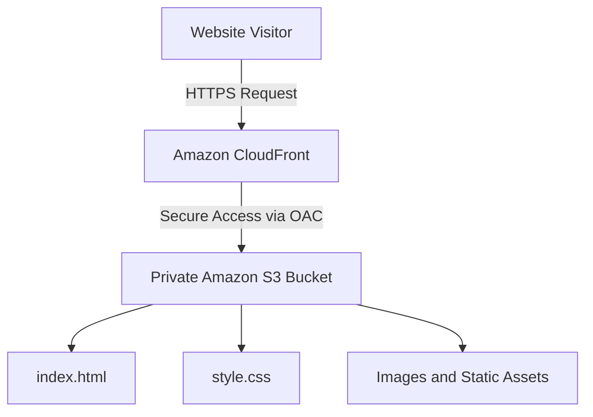
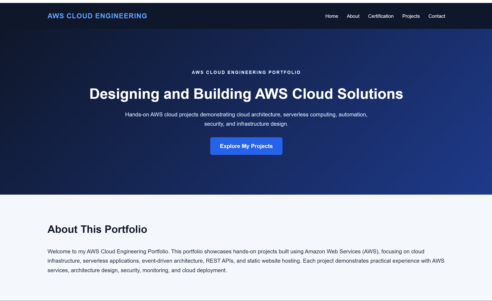
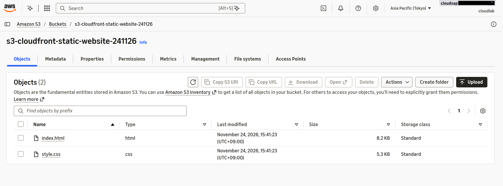
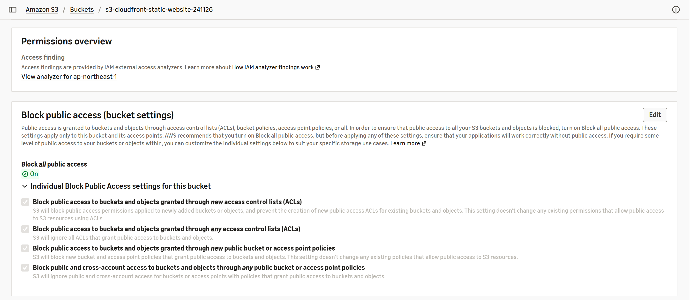
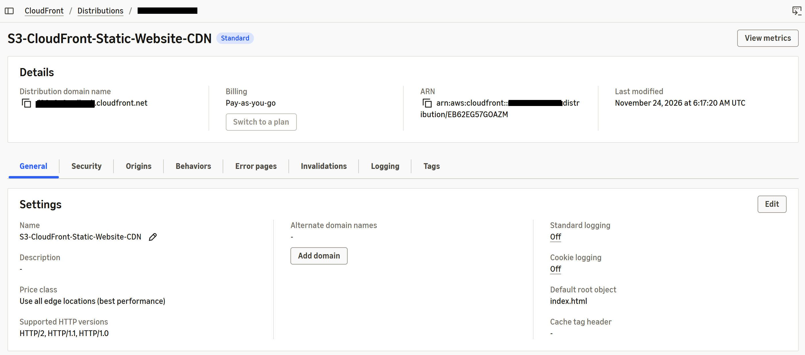
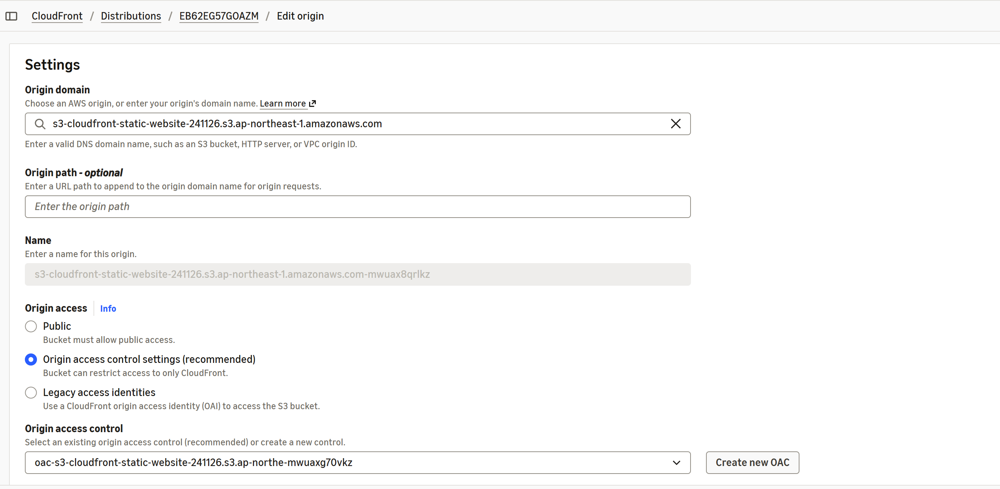
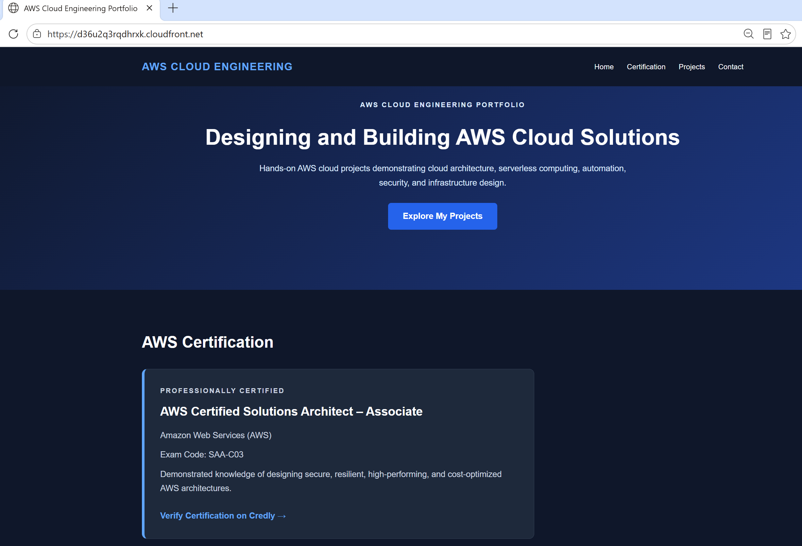

# AWS S3 Static Website Hosting with CloudFront

## Project Overview

This project demonstrates how to host a static website using Amazon S3 and securely deliver it through Amazon CloudFront.

The S3 bucket is configured as a private origin, while CloudFront uses Origin Access Control (OAC) to securely access website files.

The website is delivered over HTTPS through CloudFront, providing secure and reliable content delivery.

### Project Objectives

- Host a static website using Amazon S3.
- Configure Amazon CloudFront as a Content Delivery Network (CDN).
- Secure the S3 bucket using Origin Access Control (OAC).
- Enable HTTPS for secure website access.
- Understand AWS static website hosting and content delivery architecture.

**AWS Region:** Asia Pacific (Tokyo) — `ap-northeast-1`

---

## Architecture

The project uses Amazon S3 as the origin for static website files and Amazon CloudFront to deliver content securely to users.

### Architecture Diagram



### Request Flow

1. A visitor opens the CloudFront distribution URL using HTTPS.
2. CloudFront receives the request.
3. CloudFront uses Origin Access Control (OAC) to securely access the private S3 bucket.
4. S3 returns the requested website files.
5. CloudFront delivers the content to the visitor over HTTPS.

---

## AWS Services Used

| AWS Service | Purpose |
|---|---|
| Amazon S3 | Stores static website files |
| Amazon CloudFront | Distributes website content globally |
| Origin Access Control (OAC) | Provides secure access from CloudFront to S3 |
| AWS IAM | Controls permissions for accessing S3 resources |

---

## Website Features

- Responsive portfolio website
- AWS Cloud Engineering project showcase
- AWS Certified Solutions Architect – Associate certification section
- GitHub project links
- Contact information
- HTTPS-enabled access through CloudFront

---

## S3 Configuration

The Amazon S3 bucket stores the static website files.

### Configuration Details

- S3 bucket configured as a private origin
- Block Public Access enabled
- Website files uploaded to the bucket
- CloudFront configured to access S3 through OAC
- S3 bucket policy allows access from the CloudFront distribution

### Website Files

```text
website/
├── index.html
├── style.css
└── images/
```

---

## CloudFront Configuration

Amazon CloudFront is configured to deliver website content securely.

### Configuration Details

- Distribution name: `S3-CloudFront-Static-Website-CDN`
- Origin: Amazon S3 bucket
- Origin Access Control (OAC): Enabled
- Default root object: `index.html`
- Distribution status: Enabled
- Viewer protocol: HTTPS
- Default CloudFront domain:

`https://d36u2q3rqdhrxk.cloudfront.net`

### Security Configuration

CloudFront accesses the private S3 bucket through Origin Access Control (OAC).

Direct public access to the S3 bucket is blocked.

---

## Testing and Validation

The following tests were performed successfully:

| Test | Expected Result | Status |
|---|---|---|
| Open CloudFront URL | Website loads successfully | Passed |
| HTTPS access | Secure HTTPS connection | Passed |
| Load HTML file | Homepage displays correctly | Passed |
| Load CSS file | Website styling works correctly | Passed |
| S3 public access | Public access blocked | Passed |
| CloudFront origin access | OAC configured successfully | Passed |

---

## Project Screenshots

### 1. Live Website



### 2. S3 Bucket Configuration



### 3. S3 Block Public Access



### 4. CloudFront Distribution



### 5. CloudFront Origin and OAC



### 6. HTTPS Website Access



---

## Deployment Steps

1. Create an Amazon S3 bucket.
2. Keep Block Public Access enabled.
3. Upload website files (`index.html`, `style.css`, and images).
4. Create an Amazon CloudFront distribution.
5. Configure the S3 bucket as the CloudFront origin.
6. Configure Origin Access Control (OAC).
7. Allow the CloudFront distribution to access the S3 bucket through its bucket policy.
8. Set `index.html` as the default root object.
9. Wait for the CloudFront distribution to deploy.
10. Open the CloudFront domain using HTTPS.
11. Create a CloudFront invalidation (`/*`) after updating website files.

---

## Security Considerations

- S3 Block Public Access remains enabled.
- The S3 bucket is not publicly accessible.
- CloudFront uses Origin Access Control (OAC).
- Website visitors access the content through CloudFront.
- HTTPS is used for secure communication.

---

## Cost Considerations

This project uses AWS pay-as-you-go services.

Potential costs include:

- Amazon S3 storage and requests
- CloudFront data transfer and requests
- CloudFront invalidation requests beyond applicable free allowances

AWS billing should be monitored to avoid unexpected charges.

---

## Project Status

**Status: Completed**

Successfully deployed a static portfolio website using Amazon S3 and Amazon CloudFront with private origin access through OAC and HTTPS delivery.

---

## Key Learning Outcomes

Through this project, I gained practical experience with:

- Amazon S3 static website file storage
- Amazon CloudFront distribution configuration
- Origin Access Control (OAC)
- S3 bucket security and Block Public Access
- HTTPS content delivery
- CloudFront cache invalidation
- AWS architecture and deployment workflows

---

## Future Improvements

- Configure a custom domain using Amazon Route 53.
- Add an SSL/TLS certificate using AWS Certificate Manager.
- Configure AWS WAF for additional protection.
- Implement CI/CD deployment automation.
- Monitor usage and performance through AWS monitoring tools.

---

## Project Repository

GitHub: https://github.com/cloudsapengr/aws-s3-static-website-hosting

## Live Website

https://d36u2q3rqdhrxk.cloudfront.net

---

**Built as part of my AWS Cloud Engineering portfolio.**